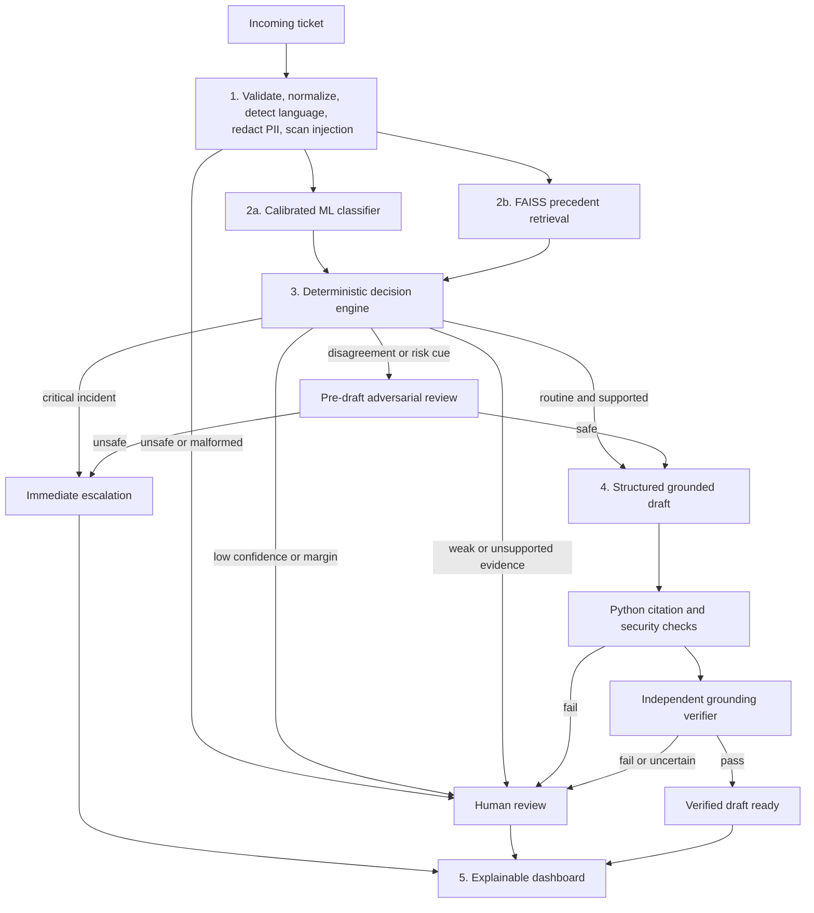

# SentinelDesk architecture and learning guide

This branch implements the five-stage design from the judge feedback. The most
important safety rule is that each stage can stop the pipeline, but no later
stage can erase an earlier safety failure.



## The two parallel signals

The classifier and RAG branch answer different questions:

- The classifier asks, “What type, queue, and priority is this?” Its scores are
  calibrated probabilities.
- RAG asks, “Have we solved anything similar before?” Its scores are cosine
  similarity and similarity-weighted vote shares.

Those numbers must not be averaged. `sentineldesk/consensus.py` therefore leaves
classifier probabilities unchanged and reports RAG agreement separately.

## Walk through the code in this order

1. `sentineldesk/schemas.py` — learn the data shapes that move between stages.
2. `sentineldesk/orchestrator.py` — read the `triage()` method from top to bottom.
3. `sentineldesk/guardrails.py` and `sentineldesk/prompting.py` — see how untrusted
   text is normalized, redacted, and serialized as JSON data.
4. `sentineldesk/classifier_interface.py`, `sentineldesk/retrieval.py`, and
   `sentineldesk/precedent_vote.py` — compare the independent model and evidence
   branches.
5. `sentineldesk/escalation.py` — inspect the deterministic gates and thresholds.
6. `sentineldesk/reply_generation.py`, `sentineldesk/verification.py`, and
   `sentineldesk/grounding_review.py` — follow a draft through three fail-closed
   checks: structured output, Python validation, and independent model review.
7. `app.py` — see how every decision and measurement reaches the dashboard.

## Decision rules

| Signal | Outcome | Why |
| --- | --- | --- |
| Blank or oversized ticket | Human review before inference | Prevent bad input and resource abuse |
| Invalid attachment count, size, MIME type, or signature | Human review before inference | Never trust a filename or declared media type |
| Unsupported language or prompt injection | Human review before inference | Untrusted instructions never reach a model |
| High-priority Incident | Immediate escalation | Optimize for critical-incident recall |
| Any classifier head below confidence or margin threshold | Human review, no LLM | An LLM cannot repair model uncertainty |
| No sufficiently similar precedent | Human review, no LLM | There is no evidence for a grounded answer |
| Requested refund/SLA/deadline absent from evidence | Human review, no LLM | Do not invent commitments |
| RAG/classifier disagreement or risk cue | Adversarial pre-draft review | Spend more compute only where useful |
| Draft fails citation/security or independent grounding review | Human review | Fail closed instead of auto-sending |
| Every check passes | Draft ready for verification | The dashboard preserves all evidence |

Thresholds live in `sentineldesk/config.py`. Tune them on validation data, never on
the held-out evaluation split.

## Run the learning version

```bash
python -m pip install -r requirements.txt
python -m pytest -q
streamlit run app.py
```

Development mode intentionally labels mock backends. For a judge demo, first
prepare the dataset, train the classifier, build the multilingual FAISS index, and
configure Gemini credentials. Then enable “Judge mode” in the sidebar; startup
will fail visibly rather than silently using mock artifacts.

```bash
python scripts/prepare_data.py --dataset full
python classification/classify.py
python -m sentineldesk.build_index
# Export GEMINI_API_KEY, or configure Google Cloud Application Default Credentials.
streamlit run app.py
```

